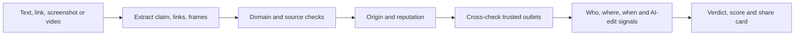

# 🛡️ Scamfix

**Check before you share.** Scamfix traces where a viral claim came from, finds the real story from trusted outlets, and flags AI-written or edited content.

> Status: working prototype (proof of concept). Looking for feedback, testers and collaborators.

## The problem

Fake and misleading "breaking news" spreads faster than corrections. Most of it arrives as a screenshot, a forward or a clip with no source, no date and no context. Increasingly, the text, images and video are AI-made or edited, which makes them hard to judge by eye.

## What Scamfix does

1. **Accepts anything:** typed text, links, screenshots (drag and drop, paste or tap) and short videos.
2. **Traces the origin:** finds the first source and rates that source's track record.
3. **Finds the real story:** compares the claim with trusted outlets such as BBC, CNN, Reuters, AP, Citizen Digital and Nation.
4. **Extracts who, where and when:** including roles, for example whether the person named really holds that position.
5. **Flags AI and edits:** gives likelihoods and the signals behind them for text, images and video frames.
6. **Checks domains:** warns about link shorteners, satire sites and lookalike news domains.
7. **Returns a verdict:** a credibility score, red flags, next steps and a shareable verdict card.

## Plans (proposed)

| | Basic (free) | Premium | Pro |
|---|---|---|---|
| Checks per day | 5 | Unlimited | Unlimited |
| Text and link checks | Yes | Yes | Yes |
| Verdict and credibility score | Yes | Yes | Yes |
| Fake-domain warnings | Yes | Yes | Yes |
| Screenshot and video checks | | Yes | Yes |
| AI-written and edited detection | | Yes | Yes |
| Who, where, when with roles | | Yes | Yes |
| Outlet side-by-side comparison | | Yes | Yes |
| Saved history and verdict cards | | Yes | Yes |
| Live search of BBC, CNN, Reuters, Citizen | | | Yes |
| Reverse image and video search | | | Yes |
| Deepfake and voice-clone analysis | | | Yes |
| Content provenance (C2PA) checks | | | Yes |
| Trending-fake alerts | | | Yes |
| Team dashboard and API | | | Yes |

Prices: to be decided.

## Prototype

The prototype lives in [`prototype/scamfix.html`](prototype/scamfix.html), a single-file web app that runs in any modern browser on iPhone, Android, Mac and Windows.

Honest limits of this version:
- The AI analysis runs through the Claude runtime where the prototype was published, so the file does **not** work standalone on GitHub Pages yet.
- There is **no live web access**. The "original story" comes from the model's knowledge, so very recent news is often marked "Unverified".
- AI and edit detection gives **signals, not proof**. Human writing is sometimes wrongly flagged, and polished fakes can pass.
- Video checks examine a few still frames only, not audio or motion.

## Roadmap

- [ ] Backend service so Scamfix runs on its own domain without a Claude sign-in
- [ ] Live news search across trusted outlets
- [ ] Maintained source-reputation database (fact-checker ratings, user reports)
- [ ] Reverse image and video search
- [ ] Dedicated deepfake and audio detection
- [ ] Installable web app (PWA), then iOS and Android wrappers
- [ ] Share-to-Scamfix from WhatsApp and social apps
- [ ] Accuracy testing on real viral claims, published openly

## How we will measure success

Run the prototype on a set of known fakes, known true stories and brand-new claims, and track: verdict accuracy, how often it says "Unverified", and the false-positive rate on real content.

## Contributing

Ideas, test cases and pull requests are welcome. Open an issue to share a claim Scamfix got wrong.

## License

MIT, see `LICENSE`.
